<p align="center">
  
</p>

<p align="center">
  
</p>

<p align="center">
  <a href="https://x.com/yousef_dev921"></a>
  
  
</p>

## About

I do security research on Apple platforms: iOS and macOS internals, code‑signing (CoreTrust / AMFI), image and file‑format parsers, and jailbreak tooling (rootless tweaks for Dopamine). I report what I find to Apple Product Security and publish the write‑ups once disclosure is complete.

Outside research, I build production software for Saudi companies and institutions.

**Currently:** auditing Apple's open‑source components toward an Apple Security Bounty submission.

## Findings

<a href="https://github.com/Yousef-Dev921/AppleEXR-DataWindow-PoC">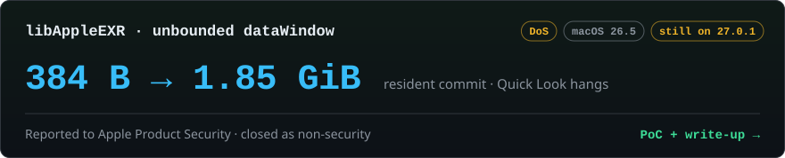</a>

<a href="https://github.com/Yousef-Dev921/ImageIO-ICNS-ChunkLength-PoC">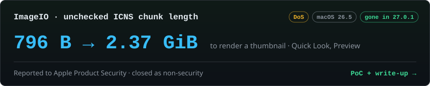</a>

## Research & open source

<a href="https://github.com/Yousef-Dev921/Coretrust-IOS-History">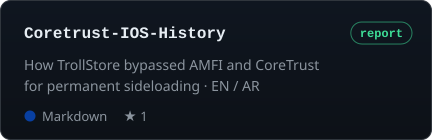</a> <a href="https://github.com/Yousef-Dev921/MuteLock">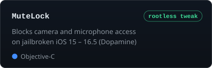</a>
<a href="https://github.com/Yousef-Dev921/tajwal-360">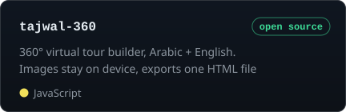</a> <a href="https://github.com/storytold/pdfcraft/pulls?q=is%3Apr+author%3AYousef-Dev921">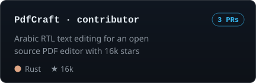</a>

## Things I build

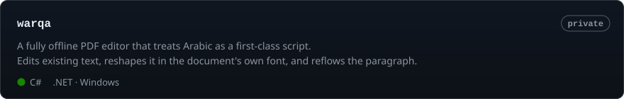

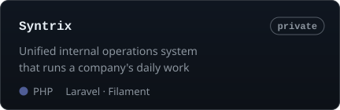 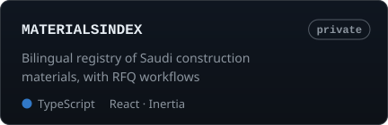
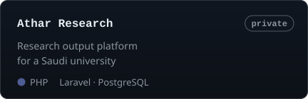

## Stack

```toml
[research]
tools   = ["C", "Objective-C", "LLDB", "Python", "Shell"]
jailbreak = ["Theos", "rootless tweaks", "Dopamine"]

[apple]
apps    = ["Swift", "SwiftUI", "Objective-C", "Firebase"]

[web]   # production ERP systems and private platforms
stack   = ["Laravel", "Inertia", "React", "Filament", "Tailwind CSS", "PostgreSQL", "Vite"]
langs   = ["PHP", "TypeScript", "Go"]

[desktop]
stack   = ["C#", ".NET (Windows)"]
```

## Activity

<picture>
  <source media="(prefers-color-scheme: dark)" srcset="https://raw.githubusercontent.com/Yousef-Dev921/Yousef-Dev921/output/snake-dark.svg">
  <source media="(prefers-color-scheme: light)" srcset="https://raw.githubusercontent.com/Yousef-Dev921/Yousef-Dev921/output/snake-light.svg">
  
</picture>
